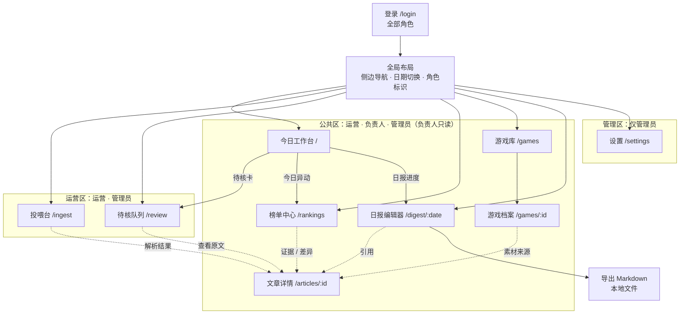
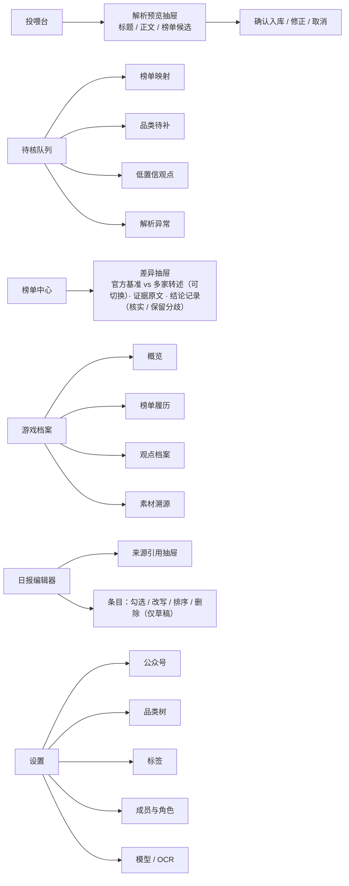

# 页面结构规划 V1.1（基于 V1.0 回写）

- 依据：《微小 / 抖小游戏榜单情报平台设计文档（PRD V1.1）》
- 文档版本：V1.1（原型冻结回写）
- 基线版本：V1.0
- 原型基线：`prototype-v0.1`（2026-10-17 冻结）
- 范围：MVP / P0
- 日期：2026-10-17
- 结论：推荐 10 个页面，已由可交互原型验证

### 修订记录

| 版本 | 日期 | 说明 |
|---|---|---|
| V1.0 | 2026-10-17 | 初版：10 页结构与角色权限矩阵 |
| V1.1 | 2026-10-17 | 根据最终原型 V0.1 回写：修正榜单中心权限与差异抽屉、补充转全文兜底与定稿锁定、同步投喂结果区说明、记录解析预览与日报纠错待确认项 |

---

## 一、页面结构图

### 1.1 页面地图与角色权限

### 1.2 页面内承载方式

> 注：原型 V0.1 的解析预览仅展示标题、来源与数量，支持确认 / 取消；“正文 / 榜单候选 / 入库前修正”是否纳入正式需求，见 §3.2 待确认项。

### 1.3 角色权限矩阵

| 页面 | 运营 | 负责人 | 管理员 |
|---|---|---|---|
| 今日工作台 | 可写 | 只读 | 可写 |
| 投喂台 | 可写 | — | 可写 |
| 待核队列 | 可写 | — | 可写 |
| 榜单中心 | 可写（处理差异） | 只读 | 可写（处理差异） |
| 游戏库 / 游戏档案 | 可写 | 只读 | 可写 |
| 日报编辑器 | 可写 | 只读 + 导出 | 可写 |
| 文章详情 | 可读 | 只读 | 可读 |
| 设置 | — | — | 可写 |

规则：未登录跳转 `/login`；越权访问提示无权限并回到工作台；负责人页面隐藏写操作入口，后端同步校验。

---

## 二、页面功能概览

| # | 页面（路由） | 主要用途 | 关键操作 | 承载形式 |
|---|---|---|---|---|
| 1 | 登录 `/login` | 身份验证与角色进入 | 输入密码登录、按角色进入工作台 | 独立页 |
| 2 | 今日工作台 `/` | 每日第一屏 | 看待核数、今日异动、日报进度；跳转投喂 / 待核 / 榜单 / 日报 | 独立页，卡片聚合 |
| 3 | 投喂台 `/ingest` | 三通道入库 | 批量链接、截图上传或粘贴、全文粘贴；解析预览；确认入库；重复提示 | 独立页 + 预览抽屉 |
| 4 | 待核队列 `/review` | 集中处理不确定项 | 映射已有游戏、新建游戏、补 L2/L3 品类、确认观点、重试解析、转全文兜底 | 独立页 + 4 个标签页 |
| 5 | 榜单中心 `/rankings` | 核对榜单事实 | 按平台 / 榜种 / 日期筛选；官方基准与多家转述并列/切换；暂定快照标注；差异标红；查看证据；记录结论（核实或保留分歧） | 独立页 + 差异抽屉 |
| 6 | 游戏库 `/games` | 查找游戏 | 关键词、平台、品类筛选；进入档案 | 独立页 |
| 7 | 游戏档案 `/games/:id` | 沉淀游戏七维信息 | 编辑基础身份、维护别名与品类、查看榜单履历与观点、跳转原文 | 独立页 + 标签页 + 编辑抽屉 |
| 8 | 日报编辑器 `/digest/:date` | 初稿到定稿 | 生成 / 重新生成、勾选、改写、排序、删除、定稿、导出 Markdown；定稿后锁定，仅保留导出 | 独立页 + 来源抽屉 |
| 9 | 文章详情 `/articles/:id` | 溯源与异常处理 | 查看正文 / 截图 / OCR、抽取结果与管道状态；失败重试 | 独立页，可返回来源页 |
| 10 | 设置 `/settings` | 基础配置 | 公众号、三级品类树、标签、成员角色、模型 / OCR 配置与连通测试 | 独立页 + 5 个标签页 |

说明：日报不设独立历史列表页，通过日期切换器访问任意日期；排行榜趋势图、品类看板、关联关系推荐、日报历史对比均属 P1，不进入本期页面。

---

## 三、关键交互检查

### 3.1 主任务链路

| 主任务 | 页面路径 | 检查结果 |
|---|---|---|
| 每日投喂 20 篇 | 工作台 → 投喂台 → 解析预览 → 入库结果 / 重复提示 → 文章详情 | 通过 |
| 待核清零 | 工作台待核卡 → 待核队列（映射 / 品类 / 观点 / 异常）→ 处理 → 返回工作台 | 通过 |
| 榜单交叉核对 | 榜单中心 → 官方基准 vs 多家转述 → 差异抽屉 → 证据原文 → 记录结论（核实 / 保留分歧） | 通过 |
| 游戏档案沉淀 | 游戏库 → 游戏档案 → 概览 / 履历 / 观点 / 溯源 | 通过 |
| 日报产出 | 工作台进度 → 日报编辑器 → 生成 → 勾选 / 改写 / 排序 → 定稿 → 导出 | 通过 |
| 负责人抽查 | 日报或榜单 → 引用抽屉 → 文章详情（只读） | 通过 |
| 管理员配置 | 设置 → 公众号 / 品类树 / 标签 / 成员 / 模型 | 通过 |

### 3.2 可能遗漏或需确认项

| 项 | 处理建议 | 是否阻塞 |
|---|---|---|
| 现有实施计划前端仅列 7 个页面，缺待核队列与文章详情 | 已解决：原型 V0.1 已补齐为 10 页 | 否 |
| 分歧处理无独立页面 | 结论记录放在榜单中心差异抽屉，不单设工作台；主动分歧提示属 P1 | 否 |
| 日报跨日期查看 | 编辑器顶部日期切换；不新增历史页，历史对比属 P1 | 否 |
| 批量投喂的任务进度 | 原型按时间倒序展示状态，未提供筛选；建议改为“结果区展示状态，状态筛选作为可选增强，不单设任务页” | 否 |
| 负责人只读边界 | 前端隐藏写操作，后端按角色校验；细粒度权限属二期 | 否 |
| 无全局搜索与消息通知 | MVP 不新增；用工作台卡片、游戏库搜索替代 | 否 |
| 关联关系维度 | PRD 归入 P1，游戏档案本期不展示 | 否 |
| 解析预览的正文 / 榜单候选与修正 | 原型仅支持确认 / 取消；是否纳入正式需求待确认，确认前不修改页面方案 | 否 |
| 日报定稿后的纠错入口 | 原型定稿后锁定且无撤销 / 重开；是否增加撤销定稿或版本化待确认 | 否 |

---

## 四、结论

推荐采用上述 10 页结构：6 个公共页、2 个运营页、1 个管理页、1 个登录页，辅以解析预览、差异对比、来源引用 3 类抽屉和标签页承载细分操作。

原型 V0.1 已完成并冻结，可作为正式开发基线。解析预览编辑粒度、日报定稿后纠错入口两项待确认，见 §3.2；确认前不改变页面方案。

---

## 五、版本与基线

- 文档版本：V1.1（原型冻结回写）
- 文件路径：`docs/页面结构规划-V1.0.md`（文件名沿用 V1.0，内容版本 V1.1）
- 原型版本：V0.1（2026-10-17 冻结）
- 完整资产版本与位置记录见 PRD §18「产品设计基线」。
